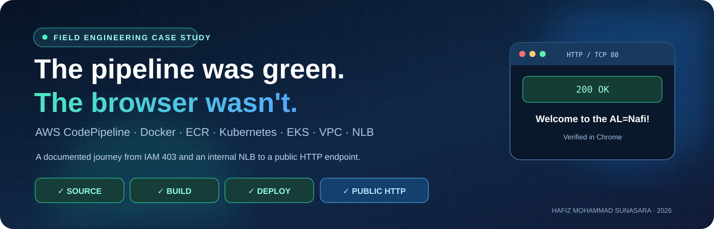
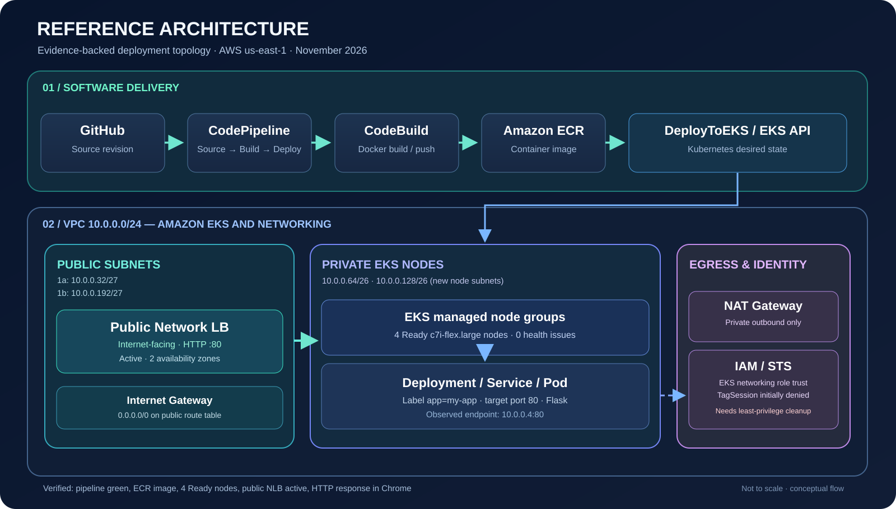
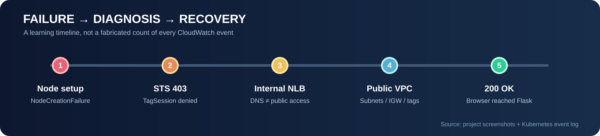

# From Green Pipeline to a Publicly Reachable Application

### A real AWS CI/CD + Kubernetes engineering case study

   

**Built and documented by [Hafiz Mohammad Sunasara](https://github.com/HafizMohammadSunasara)**  
*Cloud & DevOps engineering | November 2026*

[Explore the architecture](docs/architecture.md) · [See live evidence](docs/evidence.md) · [Read the incident casebook](docs/incident-casebook.md) · [See the learning roadmap](docs/roadmap.md)

---

> **The story:** Source ✅ · Build ✅ · Deploy ✅ — yet the browser could not reach the app. The pipeline was green, but the job wasn't finished. Investigating IAM session tagging, EKS load-balancer reconciliation, subnet discovery and VPC routing turned this from a simple hello-world deployment into a real troubleshooting case study.

## The result, in one glance

| Verified result | Evidence |
|---|---|
| GitHub source, build and EKS deploy stages all succeeded | [Pipeline execution](evidence/screenshots/01-pipeline-green.png) |
| Container image present in Amazon ECR | [ECR image list](evidence/screenshots/02-ecr-images.png) |
| Four Kubernetes nodes reported **Ready**, zero node health issues | [EKS compute](evidence/screenshots/03-eks-nodes.png) |
| Public Network Load Balancer reported **Active**, **Internet-facing** | [NLB detail](evidence/screenshots/04-public-nlb.png) |
| Chrome loaded the app through the NLB DNS name | [Browser response](evidence/screenshots/05-public-browser.png) |

### What actually runs

- **Application:** small Python/Flask HTTP service that returns `Welcome to the AL=Nafi!` at `/`.
- **Delivery:** GitHub (via GitHub App/CodeConnections) → AWS CodePipeline → AWS CodeBuild → Docker → Amazon ECR → Amazon EKS deploy stage.
- **Runtime:** Amazon EKS, Kubernetes Deployment/Pod/Service, managed EC2 node groups.
- **Network:** VPC `10.0.0.0/24`; public NLB spanning two public subnets; private node subnets; NAT egress and internet-gateway ingress.
- **Externally tested:** HTTP port `80`, internet-facing NLB. This was a **working learning deployment**, not a production-certified system.

> **Demo caveat:** This raw, AWS-managed hostname may stop resolving if the laboratory infrastructure is stopped or deleted. It uses **HTTP, not HTTPS**. The screenshot is the durable proof of the Nov 15, 2026 test.

## Why this matters in the real world

Imagine a small product team deploying an API multiple times per week. Copying code manually to servers introduces configuration drift, hard-to-reproduce releases and uncertain rollback procedures. A delivery pipeline makes build-and-release steps repeatable; a registry stores immutable container artifacts; Kubernetes manages application placement and restarts; VPC routing and load-balancers determine whether real users can reach the result.

This lab exercises the **integration points** where outages happen:

| Engineering question | This project demonstrates |
|---|---|
| How does a commit reach a cluster? | Connected source, build and deploy stages |
| Where does the deployable artifact live? | Docker image stored in ECR |
| Where is the application scheduled? | EKS Deployment, Pod and node groups |
| Why can all pipeline stages be green while users see nothing? | Internal vs internet-facing load-balancer scheme |
| What breaks load-balancer provisioning before the NLB exists? | EKS Auto Mode IAM/STS `TagSession` denial |
| Why do public and private subnet routes differ? | IGW for internet ingress, NAT for outbound-only private egress |
| What needs hardening before production? | Identity separation, HTTPS, observability, costs, configuration as code |

## Repository map

| Path | Purpose |
|---|---|
| [`app.py`](app.py), [`requirements.txt`](requirements.txt), [`Dockerfile`](Dockerfile) | Original Flask/Docker application files, preserved from the GitHub source snapshot |
| [`.dockerignore`](.dockerignore), [`tests/test_app.py`](tests/test_app.py) | Keep portfolio screenshots out of Docker build context; provide a minimal local HTTP smoke test (not claimed as CI evidence) |
| [`buildspec.yml`](buildspec.yml) | Credential-free **portfolio-safe revised** build example; compare with caveats in [source provenance](docs/source-provenance.md) |
| [`k8s-deployment.yml`](k8s-deployment.yml) | Original Deployment and internal Service definition, preserved for historical fidelity |
| [`k8s/my-app-public-service.yml`](k8s/my-app-public-service.yml) | Actual internet-facing Service pattern used in the verified fix |
| [`assets/`](assets/) | Custom vector graphics: architecture, VPC traffic and incident lifecycle |
| [`docs/architecture.md`](docs/architecture.md) | Deep dive: every network and delivery hop |
| [`docs/incident-casebook.md`](docs/incident-casebook.md) | Chronological errors, symptoms, diagnosis, actions and confidence levels |
| [`docs/production-readiness.md`](docs/production-readiness.md) | Risks, IAM, TLS, security, cost and next engineering steps |
| [`docs/evidence.md`](docs/evidence.md) | Visual proof and a traceable screenshot index |
| [`docs/roadmap.md`](docs/roadmap.md) | Prioritized longer-term learning and investment roadmap |
| [`docs/interview-guide.md`](docs/interview-guide.md) | Recruiter-friendly explanations and interview questions |
| [`docs/reproduce.md`](docs/reproduce.md) | Setup prerequisites and safe workflow, without pretending infrastructure is one-command reproducible |

## Failure became the best part of the project

The most useful incident was a failed `LoadBalancer` Service. `kubectl describe service my-app-service -n default` repeatedly reported `FailedBuildModel`, followed by STS **AccessDenied for `sts:TagSession`** while trying to use an EKS/CodeBuild-shared IAM role. Once IAM conditions were corrected, an NLB appeared — but it was **Internal**, which was still wrong for a browser-facing demo. Two tagged public subnets, correct `0.0.0.0/0 → Internet Gateway` routing, and an explicitly **internet-facing** EKS Auto Mode Service solved the final reachability problem.

Full log excerpts, exact observations and unresolved questions: **[Incident casebook →](docs/incident-casebook.md)**.

## Honest scope

**Verified:** a successful pipeline execution, an ECR image, four Ready nodes, a public NLB, and the app loading in a Chrome browser.

**Not yet verified / incomplete:** TLS and domain, image scanning enforcement, automated tests in the *current* build stage, deployment rollback, infrastructure as code, alerting/SLOs, isolated least-privilege IAM roles, full replication of this environment from the ZIP, and removal of the old internal NLB. Some historical errors were reported in earlier attempts and do not belong to the final deployment; these are marked separately.

**Security note:** an access token was found in the original public buildspec. It has **not** been copied into this ZIP. The owner must revoke/rotate it and review Git history before further distribution. See [SECURITY.md](SECURITY.md).

---

**The pipeline became green first. The application became reachable later. Both milestones mattered.**

[Architecture](docs/architecture.md) · [Troubleshooting](docs/incident-casebook.md) · [Evidence](docs/evidence.md) · [What I'd improve next](docs/roadmap.md)

