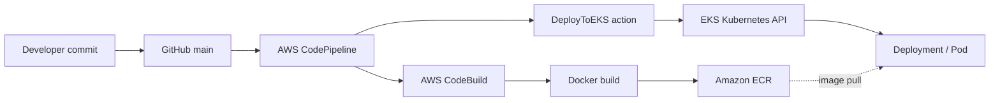
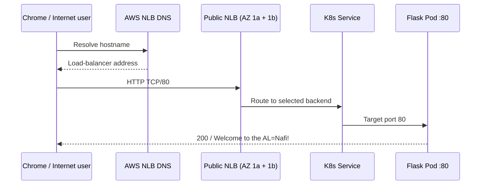

# Architecture deep dive — from a Git commit to an HTTP response

> **Snapshot:** November 14–15, 2026 · AWS `us-east-1` · EKS cluster `eks` · VPC `10.0.0.0/24`. This page is an engineering explanation of the observed topology, not a claim that the entire VPC was provisioned by IaC.


## 1. Delivery control plane



1. **Source:** CodePipeline reads the GitHub repository via GitHub App/connection. A source revision is associated with an execution.
2. **Build:** CodeBuild runs the build configuration; the evidenced image is stored in the `eks-ecr-app` private ECR repository. ECR is an artifact registry, not the runtime.
3. **Deploy:** A distinct `DeployToEKS` pipeline stage reported success. Kubernetes desired state is represented in `k8s-deployment.yml`; confirm the stage artifact mapping before changing the live pipeline.
4. **Runtime:** The Deployment selector `app=my-app` selects its Pod(s); the Service selects the same label and sends incoming traffic to container port `80`.

> **Source fidelity:** The GitHub snapshot contained a legacy `buildspec.yml` that also attempted `kubectl` deployment. This *does not prove* the current Build action ran those commands; the pipeline may override the buildspec. The portfolio buildspec is a **sanitized, revised example**, not proof of the precise executable command set used on the successful run.

## 2. Network topology — the part that initially blocked the browser


The VPC is unusually small for a production EKS deployment: `10.0.0.0/24` (256 total IPv4 addresses). It was reused from an existing lab. Multiple subnet generations were visible:

| Subnet | CIDR | Role at verification | Path to `0.0.0.0/0` |
|---|---|---|---|
| Old subnet 1 | `10.0.0.0/28` | Original worker-node subnet | Existing VPC route; inspect before reusing |
| Old subnet 2 | `10.0.0.16/28` | Original worker-node subnet | Existing VPC route; inspect before reusing |
| `eks-public-a` | `10.0.0.32/27` | Public NLB placement, AZ 1a | **IGW** through `eks-public-rt` |
| `eks-private-a` | `10.0.0.64/26` | Private nodes / egress | **NAT** through main route table |
| `eks-private-b` | `10.0.0.128/26` | Private nodes / egress | **NAT** through main route table |
| `eks-public-b` | `10.0.0.192/27` | Public NLB placement, AZ 1b | **IGW** through `eks-public-rt` |

The last four CIDRs are disjoint. Two `/27` public subnets were added specifically for public load-balancer placement. AWS reserves five addresses per subnet; with the `/27` capacity, the new public subnets have room for NLB provisioning, subject to other consumption.

### Route tables

**Public route table** `eks-public-rt` (explicitly associated with both public subnets):

| Destination | Target | Meaning |
|---|---|---|
| `10.0.0.0/24` | `local` | Intra-VPC routing |
| `0.0.0.0/0` | Internet Gateway `igw-055edabce7856d0b5` | Internet connectivity for public infrastructure |

**Private route** observed on both new private subnets:

| Destination | Target | Meaning |
|---|---|---|
| `10.0.0.0/24` | `local` | Intra-VPC routing |
| `0.0.0.0/0` | NAT Gateway `nat-1a589ed4577c991e4` | Outbound internet access without direct inbound access |

The public route table was **briefly configured with a NAT target** during setup, then corrected to the existing attached Internet Gateway. This was a configuration mistake caught before public access validation.

### Why `kubectl get svc` initially lied by omission

It didn't lie: an EKS Service with `EXTERNAL-IP` set to a DNS hostname proves that an NLB resource was provisioned. It does **not** prove that hostname is internet-reachable. The first NLB was explicitly shown as **Internal**. Its DNS was correctly provisioned but wasn't a public entry point. The second Service used:

```yaml
metadata:
  annotations:
    service.beta.kubernetes.io/aws-load-balancer-scheme: "internet-facing"
    service.beta.kubernetes.io/aws-load-balancer-subnets: "subnet-0d8dc47988a86725c,subnet-059613c53f880d31e"
spec:
  type: LoadBalancer
  loadBalancerClass: eks.amazonaws.com/nlb
  selector:
    app: my-app
```

The EKS Auto Mode service class provisions a **Network Load Balancer**. The new Service was named `my-app-public-service`, avoiding an in-place scheme change to the running original Service. The browser then fetched the Flask response over HTTP.

## 3. EKS compute and scheduling


- Four EC2-backed worker nodes were shown **Ready**, with **0 reported node-health issues**.
- Two node groups existed: `eks-app-nodes` and `eks-app-nodes-v2`.
- All four visible instances were `c7i-flex.large`, On-Demand.
- Pods and node placement are **not identical to subnet placement**: the load balancer lives in public subnets while traffic can reach backends in the VPC via appropriate networking/security-group rules.
- Kubernetes Service selector `app=my-app` matched the Deployment label; `kubectl describe` displayed backend `10.0.0.4:80` at the time.

**No HA overclaim:** two AZs and four nodes are available, but only one application replica was documented. Availability-zone redundancy for the *application itself* has not been demonstrated through multi-replica spreading, disruption budgets, or failover tests.

## 4. Public request: hop-by-hop



This is a **logical** Kubernetes view; an NLB can directly target pod IPs and does not literally send a network packet through the Kubernetes API Service object. Service is the desired-state abstraction configuring the route.

## 5. Identity and trust boundary

- **CodeBuild role:** should build/test/push to ECR; permissions for Docker Hub are unnecessary for the observed ECR-only flow.
- **EKS control-plane role:** AWS-managed EKS reconciliation needs role trust allowing supported STS actions; `sts:TagSession` denial was directly observed.
- **Node instance role:** pulls images from ECR and operates with Kubernetes/control-plane integration.
- **Kubernetes authorization:** an IAM permission to call EKS does not automatically grant Kubernetes permissions; access entries/RBAC are a separate boundary.

In this snapshot the cluster role pointed at a `codebuild-*` service role with numerous attached policies. It worked after troubleshooting but is **not a design to copy**. Split service roles and minimize permissions in future iterations.

## 6. Exact engineering trade-offs

| Choice made | Benefit | Cost / debt |
|---|---|---|
| Existing VPC `/24` | Reused infrastructure, fast iteration | Small IP pool and old tiny subnets |
| Two new public `/27` subnets | Public NLB can span two AZs | Additional addresses/routing to administer |
| Separate new public Service | Existing app Service stays untouched | Two NLBs billed until cleanup |
| AWS Auto Mode NLB | EKS-managed provisioning | Depends on AWS IAM trust and subnet tags |
| HTTP direct DNS | Easy end-to-end confirmation | Not encrypted, DNS ephemeral |
| Console-first setup | Great troubleshooting learning | Not reproducible without IaC |

## 7. References

- [EKS Auto Mode NLB annotations](https://docs.aws.amazon.com/eks/latest/userguide/auto-configure-nlb.html)
- [EKS Auto Mode subnet tagging](https://docs.aws.amazon.com/eks/latest/userguide/tag-subnets-auto.html)
- [AWS VPC route tables](https://docs.aws.amazon.com/vpc/latest/userguide/VPC_Route_Tables.html)
- [Kubernetes Service concept](https://kubernetes.io/docs/concepts/services-networking/service/)

*All AWS identifiers shown are lab resource identifiers, not credentials. Review before publishing an unrestricted copy.*
