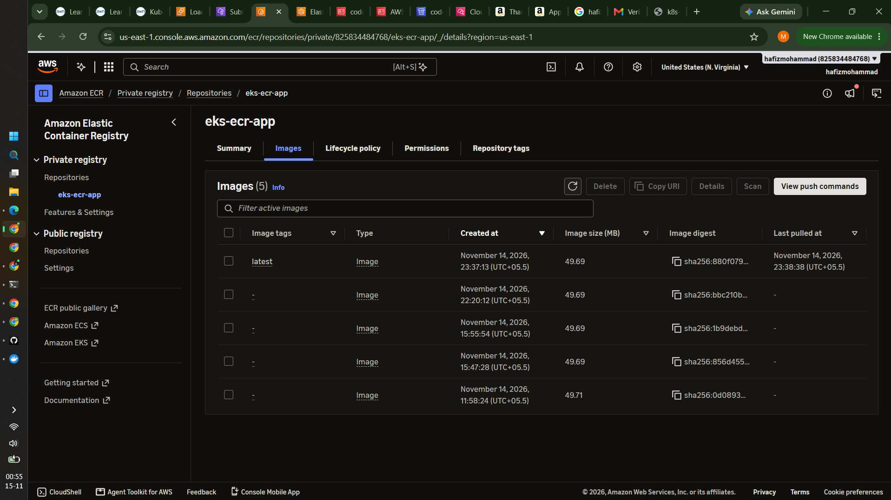
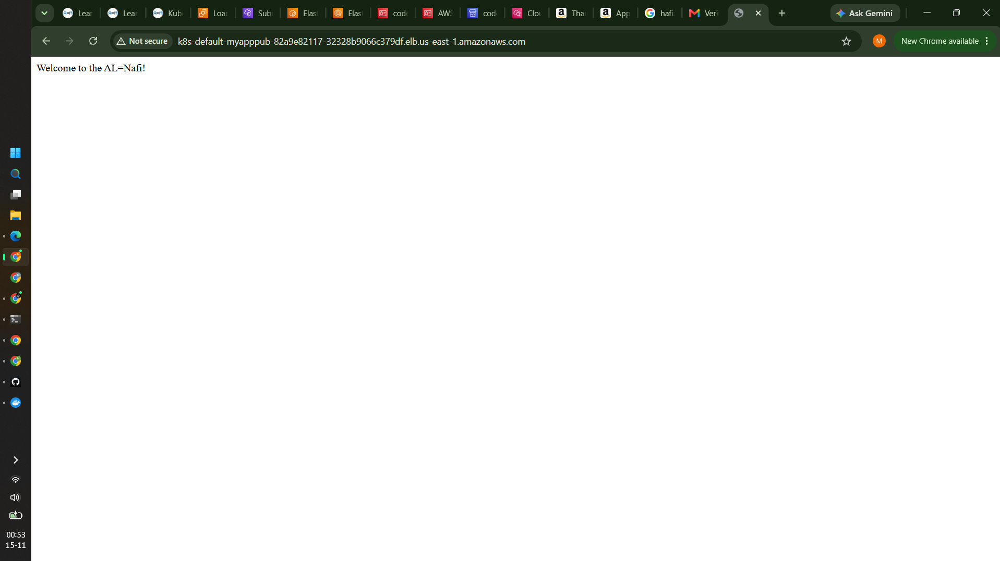
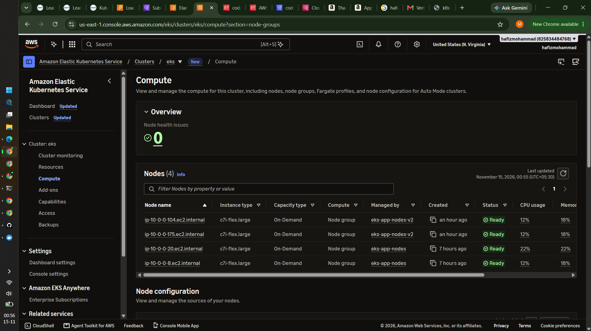
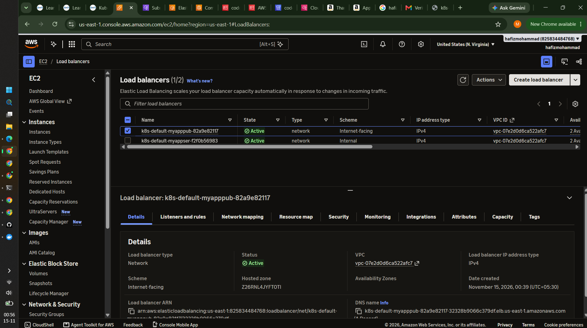
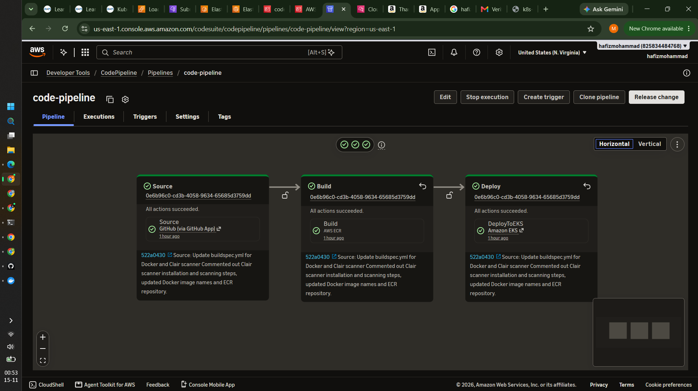

# Proof of work — original captured evidence

> **Evidence policy:** These are the user's original AWS and browser screenshots, copied without editing. Screenshots document a point in time; they do not establish all future availability, security or failover properties. Before publishing, review AWS account IDs, user handles, timestamps and resource names that appear in browser headers.

## Five primary proof points

### 01 — CodePipeline delivery succeeded

The pipeline named `code-pipeline` shows its **Source (GitHub App)**, **Build (AWS ECR)** and **Deploy (Amazon EKS)** actions succeeded for the displayed execution. A green execution is not itself proof of user connectivity.

### 02 — Image stored in ECR

ECR repository `eks-ecr-app` contained five visible images, with a `latest` tag on the first. The screenshot shows a recent pull of that latest image; it does not prove which image digest a historical pod was executing.

### 03 — EKS compute ready

Cluster `eks` displayed four `Ready` EC2 nodes across two managed node groups and **zero reported node health issues**. The screenshot alone is not proof of application-level multi-AZ high availability.

### 04 — Public Network Load Balancer active

The active NLB has scheme **Internet-facing**. Earlier there was a separate Internal NLB; both are shown together in evidence 06.

### 05 — Browser received the application

Final public HTTP response reads **`Welcome to the AL=Nafi!`**. Chrome also displays **Not secure**, an expected warning because HTTPS/TLS wasn't configured.

## Investigations and course corrections

| Screenshot | What it proves / why it matters |
|---|---|
| [06 — Two active NLBs](../evidence/screenshots/06-two-load-balancers.png) | An Internet-facing NLB and an Internal NLB coexisted; extra cost needs cleanup |
| [07 — Service details](../evidence/screenshots/07-service-internal-detail.png) | The original Service is `LoadBalancer`, port `80`, selector `app=my-app` |
| [08 — IAM role trust](../evidence/screenshots/08-iam-role-trust.png) | Shows edited AWS IAM role trust; combine with exact `sts:TagSession` error log |
| [09 — IAM policy list](../evidence/screenshots/09-iam-policies.png) | Illustrates broad permissions and identity separation debt |
| [10 — Reconciliation](../evidence/screenshots/10-service-reconciliation.png) | `SuccessfullyReconciled` followed repeated `FailedBuildModel` warnings |
| [11 — Public subnet associations](../evidence/screenshots/11-public-route-associations.png) | Both public subnets assigned to designated route table |
| [12 — Initial route mistake](../evidence/screenshots/12-route-initial-wrong.png) | Initial public default route was NAT, later changed |
| [13 — Internet Gateway](../evidence/screenshots/13-internet-gateway.png) | IGW existed and was attached to the VPC |
| [14 — Private subnet tag mistake](../evidence/screenshots/14-private-subnet-tag-mistake.png) | Public `elb` role tag was initially applied to a private subnet |
| [15 — Public subnet A tag](../evidence/screenshots/15-public-subnet-a-tag.png) | Tag update saved for `eks-public-a` |
| [16 — Public subnet B tag](../evidence/screenshots/16-public-subnet-b-tag.png) | Tag update saved for `eks-public-b` |
| [17 — Public Service creation](../evidence/screenshots/17-create-public-service.png) | `my-app-public-service` created with internet-facing annotation |
| [18 — Public Service external DNS](../evidence/screenshots/18-public-service-external-dns.png) | Service obtained load-balancer hostname |
| [19 — Baseline VPC](../evidence/screenshots/19-vpc-baseline.png) | Existing VPC `10.0.0.0/24` |
| [20 — Pipeline alternative view](../evidence/screenshots/20-pipeline-alternative-view.png) | Another view of the all-green CodePipeline execution |
| [21 — Private route](../evidence/screenshots/21-private-route.png) | One of the troubleshooting VPC routing views |

## Text evidence

An original pasted `kubectl` event log was available, with repeated full STS request IDs. To avoid circulating those request IDs and the account-specific assumed-role ARN unnecessarily, the incident casebook quotes the **error substance** with account details abbreviated. The critical sequence is preserved:

1. `my-app-service` Service had `EXTERNAL-IP <pending>`.
2. `FailedBuildModel` → `DescribeRouteTables` credential refresh → `STS: AssumeRole` → `403 AccessDenied: sts:TagSession`.
3. After IAM/reconciliation work, `SuccessfullyReconciled` appeared.
4. New public Service created and obtained an NLB hostname.
5. Chrome returned the app's HTTP response.

See [full incident casebook](incident-casebook.md).

## Evidence integrity limitations

- The screenshot labels were assigned for navigation; the raw images themselves were not manipulated.
- Some photos include active account identifiers and usernames; decide whether to keep them in a public portfolio. **No secret access token is included in the ZIP source files.**
- Earlier failed CodeBuild/NodeClass attempts do not all have exported raw logs; these are clearly marked *Earlier reported* in the casebook.
- The GitHub source snapshot was fetched from the public `main` branch during portfolio preparation; some current AWS build settings may not match that file exactly.
