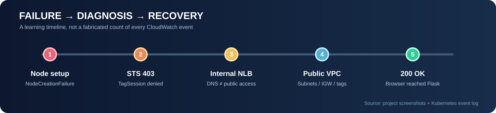
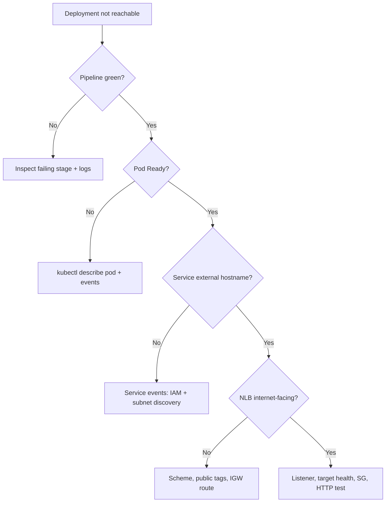

# Incident casebook — errors, investigations, and what fixed them



> This is an **evidence-driven reconstruction**, not an invented day-by-day execution log. The user asked for every error from the first attempt to the final success. The available evidence includes screenshots, a pasted `kubectl` event log, the actual GitHub source snapshot, and recalled troubleshooting notes from earlier **related** attempts. Not every early CloudWatch line is accessible. Entries are therefore labeled **Direct evidence**, **Earlier reported**, or **Discovered during review**. Unknown causes remain unknown. Old experiments such as `FlaskCICDPipeline`, SprintBoard, and earlier EKS clusters are **separate attempts**, not the final green pipeline.

## Fast incident index

| ID | Attempt / phase | Symptom or error | Evidence level | What the final state shows |
|---|---|---|---|---|
| 01 | Earlier EKS cluster | Nodes failed to appear / `NodeCreationFailure` | Earlier reported | Later cluster had 4 Ready nodes |
| 02 | Earlier EKS Auto Mode experiment | `NodeClassReady=False`, `DependenciesNotReady`, `Ready=False`, 0 nodes | Earlier reported | Different environment; not a claim about final cluster |
| 03 | Earlier CodeBuild experiment | `PRE_BUILD` `COMMAND_EXECUTION_ERROR`, exit 1 | Earlier reported | Cause not proven |
| 04 | Earlier `FlaskCICDPipeline` | `POST_BUILD`: Kubernetes requested credentials | Earlier reported | EKS access entry added in that attempt |
| 05 | Current pipeline's EKS Deploy stage | `Action failed with status: FAILED, null` | Earlier reported | A later execution showed Deploy success |
| 06 | Current cluster/node group | Group `eks-app-nodes`: `Create failed` / `NodeCreationFailure` despite Ready nodes | Earlier reported | `eks-app-nodes` and `eks-app-nodes-v2` later showed Ready nodes |
| 07 | Current EKS Service | `EXTERNAL-IP: <pending>` | Direct `kubectl` log | NLB eventually provisioned |
| 08 | Current EKS Service | Repeated `FailedBuildModel`, STS `403 AccessDenied: sts:TagSession` | **Direct error log** | `SuccessfullyReconciled` later |
| 09 | Current networking | Initial NLB `Scheme: Internal`, browser couldn't reach it | **Direct screenshot** | New internet-facing NLB verified |
| 10 | Current VPC expansion | Old `/28` subnets were too constrained for growth | Direct history/screenshots | Four new `/26` + `/27` subnets created |
| 11 | Public route table construction | Public `0.0.0.0/0` initially targeted a NAT Gateway | **Direct screenshot** | Corrected to Internet Gateway |
| 12 | EKS subnet discovery setup | ELB public tag accidentally placed on `eks-private-a` | **Direct screenshot** | User reported removing it; correct public tags added |
| 13 | Final public Service | A new NLB had to reconcile and obtain DNS | Direct `kubectl`/screenshots | HTTP endpoint responded in Chrome |
| 14 | Security review | Hardcoded Docker Hub PAT in public `buildspec.yml` | **Direct repository source** | Token omitted from ZIP; revocation must be done by owner |
| 15 | Source review | Built image/tag and pushed image/tag don't match in historical buildspec | **Direct repository source** | Corrected *example* shipped; not live verified |
| 16 | Architecture review | Shared CodeBuild/EKS role with broad policies | Direct IAM/CLI evidence | Security debt, not a proven extra runtime failure |

## Timeline A — earlier attempts (different resources, explicitly separated)

### INC-01 · EKS managed node group creation failed

**Observation:** An earlier `lab-ebs-eks` cluster showed zero nodes. On the later `eks` cluster, `eks-app-nodes` showed `Create failed` with `NodeCreationFailure`, although at least two EC2 nodes displayed as Ready.

**What this means:** EKS node-group provisioning status and individual Kubernetes node readiness are related but different. A failed group rollout does not necessarily mean every instance is down.

**Investigations discussed:** worker-node IAM policies, usable subnet capacity, networking to EKS/ECR, add-ons (`vpc-cni`, `kube-proxy`, `coredns`), and access between nodes and the control plane.

**Root cause:** **Not conclusively captured** for the historical failed group. It would be dishonest to say an IAM policy alone fixed it. The subsequent screenshot shows four Ready nodes in two node groups. The precise intervention that resolved the `Create failed` resource was not proved by an isolated before/after event log.

**Prevention:** inspect `aws eks describe-nodegroup`, node group health issues, ASG activity and EC2 launch errors before rebuilding a cluster. Distinguish node readiness from node-group health.

### INC-02 · EKS Auto Mode NodeClass / NodePool had no nodes

**Earlier independent attempt:** `NodeClassReady=False` with `DependenciesNotReady` / `Node Class Readiness Unknown`; `sprintboard-nodepool Ready=False`, nodes `0`. Subnets, security group and instance profile eventually appeared ready. This belongs to an **earlier Auto Mode experiment**, not the final `eks` screenshot.

**Root cause:** unconfirmed by the available NodeClass condition detail. Generic suspects include IAM, subnet selection, instance profile, EC2 quota and bootstrap, but they are **not established facts** for this incident.

### INC-03 · CodeBuild `PRE_BUILD` failed immediately

**Earlier independent attempt:** `COMMAND_EXECUTION_ERROR`, exit code 1, with a phase failure in under one second. No failing command text was available. At the time the team checked variables such as `AWS_ACCOUNT_ID`, `IMAGE_REPO_NAME`, `EKS_CLUSTER_NAME`, `K8S_NAMESPACE`, privileged mode and CodePipeline source revision.

**Root cause:** **Unknown.** Missing variables and revision handling were hypotheses, not findings. An exact CloudWatch line would be required to close this incident accurately.

### INC-04 · Build/tests/ECR succeeded, `kubectl` auth failed in POST_BUILD

**Earlier `FlaskCICDPipeline` build #3:** Eight tests passed and a Docker image reached ECR, but deployment failed with:

```text
the server has asked for the client to provide credentials
You must be logged in to the server
```

**Reason:** Kubernetes API authorization was missing for the build role. An EKS Access Entry was then added for that attempt. This demonstrates the distinction between AWS API authentication and EKS Kubernetes authorization.

**Scope:** Do **not** attribute those eight test passes to the current `code-pipeline` unless its own build logs corroborate them.

## Timeline B — current `eks` / `code-pipeline` deployment

### INC-05 · EKS deploy stage failed without useful details

An intermediate `DeployToEKS` execution returned:

```text
Action failed with status: FAILED, null
```

The user reported empty CloudWatch logs; Access Entry and `AmazonEKSEditPolicy` were later present. The precise underlying failure is **unverified**. The final supplied CodePipeline screenshot shows Source, Build and Deploy all successful, so the overall milestone was eventually recovered.

**Lesson:** A generic pipeline status is an indicator, not a root-cause analysis. Inspect action execution details, role credentials, EKS access entries, target artifact and application Events; don't assume a fix without an explanatory log.

### INC-06 · Node group status contradicted node readiness

An earlier screenshot in this attempt showed `eks-app-nodes` **Create failed** / `NodeCreationFailure`, even while two nodes were Ready. A later screenshot showed four `Ready` nodes, two each from `eks-app-nodes` and `eks-app-nodes-v2`, with `0` node health issues.

**Lesson:** collect **node-group status**, **node health** and **pod readiness** separately. They are three different measurements.

### INC-07 + INC-08 · NLB pending because EKS couldn't assume the role

This is the most completely evidenced failure. Kubernetes Service existed:

```text
Name: my-app-service
Type: LoadBalancer
Selector: app=my-app
Port: 80/TCP
TargetPort: 80/TCP
Endpoints: 10.0.0.4:80
EXTERNAL-IP: <pending>
```

`kubectl describe service` included repeated events (principal/account IDs abbreviated here):

```text
Warning  FailedBuildModel  service
Failed build model due to failed to list subnets by reachability:
operation error EC2: DescribeRouteTables, get identity:
get credentials: failed to refresh cached credentials,
operation error STS: AssumeRole, StatusCode: 403,
api error AccessDenied: assumed-role/EKSNetworkingChainRole/...
is not authorized to perform: sts:TagSession
on resource: role/service-role/codebuild-kubernetes-lab-build-service-role
```

**Root cause confirmed by event:** the EKS Auto Mode networking reconciliation flow could not obtain the required STS session. `DescribeRouteTables` appeared in the failed operation chain but the underlying failure happened at **credentials/STS**, not necessarily a missing EC2 read permission.

**Investigation:** `aws eks describe-cluster --query cluster.roleArn` returned the shared `codebuild-*` role. IAM trust-policy screenshots showed EKS/EC2 principals and `sts:AssumeRole`, `sts:TagSession`; the attached permissions inventory contained many EKS, ECR and other policies.

**Remediation evidence:** IAM trust settings were adjusted during troubleshooting; the user then forced safe reconciliation by changing a Service annotation:

```bash
kubectl annotate service my-app-service -n default \
  debug-reconcile="$(date +%s)" --overwrite
```

`kubectl get events` subsequently included `Normal SuccessfullyReconciled`, and the Service obtained an NLB hostname. **Caution:** the exact smallest IAM change responsible was not independently isolated. Do not generalize “attach every AWS EKS policy” as the solution.

### INC-09 · The NLB existed, but it was Internal

AWS EC2 → Load Balancers showed **Active / Network / Internal**. The Service had a hostname, yet outside users could not reach the application. This was **not an ECR build failure** and **not a Pod problem**.

**Solution path:** retain the working internal Service; build an independent, internet-facing Service using two explicitly selected public subnets. This also avoided mutating the immutable/creation-time load-balancer scheme of the existing Service.

### INC-10 · Small subnets and insufficient address headroom

The existing `/28` subnets were constrained, and the user observed low/no free IP capacity. To create placement for worker nodes and the public NLB, separate larger private `/26` and public `/27` subnets were added within the VPC `10.0.0.0/24` space. The exact observed free-IP counts at every stage were not preserved, but the subnet CIDRs and roles were shown.

**Lesson:** subnet capacity is an availability constraint. Do the math before provisioning, including AWS-reserved addresses, EKS CNI IP demand, and room for upgrades.

### INC-11 · Public subnet routing pointed to NAT instead of IGW

The new `eks-public-rt` initially showed a default route to a NAT Gateway, despite both new public subnets being associated with it. That is egress-oriented routing, **not the required public IGW design**. The route was corrected to:

```text
0.0.0.0/0  -> igw-055edabce7856d0b5  Active
10.0.0.0/24 -> local               Active
```

The two private subnet routes remained NAT-backed. Do **not** route private EKS nodes directly to an IGW just to repair public load-balancer ingress.

### INC-12 · Public ELB tag applied to a private subnet by mistake

A screenshot showed `eks-private-a` with `kubernetes.io/role/elb=1`. That key identifies **public** load-balancer subnets for EKS Auto Mode, so it belonged on `eks-public-a` and `eks-public-b` instead. The user subsequently confirmed removing it from private-a, and separate screenshots confirmed the two public subnet tag updates (value `1`).

**Lesson:** a technically valid tag can still encode the wrong operational intent. Always verify both the resource name/CIDR **and** the tag value.

### INC-13 · Public Service created and verified end-to-end

The second Service was created without interrupting the original:

```bash
kubectl apply -f -  # using the public-service YAML in k8s/
kubectl get svc my-app-public-service -n default
```

It specified `internet-facing` and both `/27` public subnet IDs. EKS returned a new hostname. EC2 Load Balancers then showed two active NLBs: **new Internet-facing** and **old Internal**. Chrome successfully loaded `Welcome to the AL=Nafi!` using the public hostname on HTTP/80. This is the decisive *user-path validation*, not just a green pipeline badge.

## Timeline C — portfolio review uncovered security/configuration debt

### INC-14 · Sensitive token hardcoded in publicly accessible source

**Direct GitHub source review:** original `buildspec.yml` included a literal Docker Hub personal access token passed via `echo ... | docker login`. This constitutes **credential exposure** even if the token is no longer used or valid.

**Remediation:** this ZIP **does not contain that token**. It uses ECR authentication via `aws ecr get-login-password`; the repo owner must revoke/rotate the exposed token and audit its Git history and logs. See [SECURITY.md](../SECURITY.md).

### INC-15 · Inconsistent Docker tag/build/push commands

In the original GitHub source, Docker built an image tagged `eks-ecr-app`, an unrelated old image was referenced by `docker tag`, and `docker push` targeted an ECR image that was not clearly created by the previous command. This mismatch is verifiable from source, but **it was not proven to be the command path executed in the final green CodeBuild action** (overrides or later configuration may differ).

**Remediation:** the packaged **example** `buildspec.yml` builds and pushes the exact same fully qualified ECR URI. It intentionally avoids source-embedded credentials and duplicate `kubectl replace --force`. It is **not live-tested**.

### INC-16 · Shared EKS/CodeBuild role with overbroad permissions

The role inventory had numerous AWS managed EKS/ECR permissions attached to a role named like a CodeBuild service role, while the EKS Cluster `roleArn` pointed to that role. This is confirmed *security architecture debt*, not evidence that every one of those attached policies was needed. A clean production migration would use separate dedicated roles, scoped permissions and reviewed trust policies.

## Error-prevention decision tree



## Incomplete evidence: what cannot be claimed

1. The exact error message of every historical CodeBuild run was not supplied; do not invent commands, root causes or counts.
2. Earlier SprintBoard and `FlaskCICDPipeline` experiments use different resources and are not the current `eks-cicd-pipeline` production history.
3. No test report proves that the *current* pipeline ran security scanners or eight tests. Clair-related commands in the original buildspec were commented out.
4. A successful HTTP response proves connectivity and a running service, **not** TLS, disaster recovery, zero downtime, or high availability.
5. The presence of two active NLBs is a recurring-cost issue; no later screenshot proves that the original internal NLB was deleted.

### Add missing logs without rewriting history

If new original CloudWatch messages or EKS node-group events become available, add them as a new numbered incident with timestamp, full error code, observed cause, attempted interventions, whether each intervention changed the result, a screenshot link, and confidence level. Never silently replace a hypothesis with a certainty.
